  

  
  
  
  
  
  

---

Software engineer in Guayaquil, Ecuador. I started out managing databases and writing backend services in 2015, and over the years my work has settled into the intersection of data engineering, internal operational tooling, and full-stack web architecture.

Most of my day-to-day work is unglamorous on purpose. It is taking field operations and PMO reporting workflows that used to live across fragile spreadsheets, putting clean data models behind them, automating the handoffs, and making sure the dashboards update themselves without human intervention. I like systems that are boring in production and never page anyone after midnight.

Outside of work, I build **[dadejecova.com](https://dadejecova.com)**—an interactive learning platform where I write deep-dive engineering guides and build browser-based coding sandboxes.

### Stack

**Day to day:**
- **Python** — Django, FastAPI, ETL pipelines, automated reporting, and backend services.
- **TypeScript & Next.js** — App Router, React Server Components, Tailwind, and responsive client interfaces.
- **SQL & Data Modeling** — PostgreSQL schema design, query optimization, analytical datasets, and BI pipelines.
- **Docker & Linux** — Containerized microservices, Nginx reverse proxies, and reproducible deployments.

**Where I spend my evenings:**
- **Rust** — Rewriting latency-sensitive backend APIs with Axum and SQLx, trading fifteen minutes of arguing with the borrow checker for zero runtime surprises.
- **WebAssembly** — Running untrusted Python code safely inside the user's browser tab via Pyodide Web Workers.
- **Local-First Mobile** — Flutter backed by SQLCipher-encrypted SQLite when an application genuinely does not need a remote cloud database.

### Projects & Platform

- **[dadejecova v2](https://dadejecova.com)** *(in active development)* — The next-generation rewrite of my educational platform. Features **The Code Arena** (a dual-pane in-browser Python sandbox with AI code review), interactive full-stack courses, and hands-on builds like a Space Invaders API, Minimax Tic-Tac-Toe, and Socket.io Breakout. Backed by a decoupled Rust/Axum API and Next.js.
- **[dadejecova_V01](https://github.com/dadejecova/dadejecova_V01)** — The original production monorepo behind dadejecova.com. Built with Next.js, Django 5, PostgreSQL, stateless JWT auth, and Docker.
- **[poke-analytics-fastapi](https://github.com/dadejecova/poke-analytics-fastapi)** — A containerized FastAPI, SQLAlchemy, and Streamlit data platform, built as the companion codebase for my English video series on structuring small microservices cleanly from day one.
- **[catculator.co](https://catculator.co)** — A web application for mapping and visualizing cryptocurrency wallet networks so transaction graphs are legible without digging through raw block explorer tables.

### Principles I hold quietly

- A schema migration without a rollback path is just an outage waiting for a bad Tuesday.
- Compile-time guarantees (`Rust`, `SQLx`, `TypeScript`) beat runtime firefighting every single time.
- Most performance bottlenecks are just a missing database index or an accidental `N+1` query hiding inside a loop.
- If a problem can be solved with a well-indexed PostgreSQL table and a clean service layer, it does not need three message queues and a distributed mesh.
- Code should be written for the sleep-deprived engineer who has to debug it at 2am six months from now—mostly because that engineer is usually me.

### Connect

The fastest way to reach me about code is to open an issue on the relevant repository. Otherwise:

- **Platform & Blog:** [dadejecova.com](https://dadejecova.com)
- **YouTube:** [@dadejecova](https://www.youtube.com/@dadejecova)
- **LinkedIn:** [danielcoellovargas](https://www.linkedin.com/in/danielcoellovargas/)

Guayaquil, Ecuador · UTC-5
